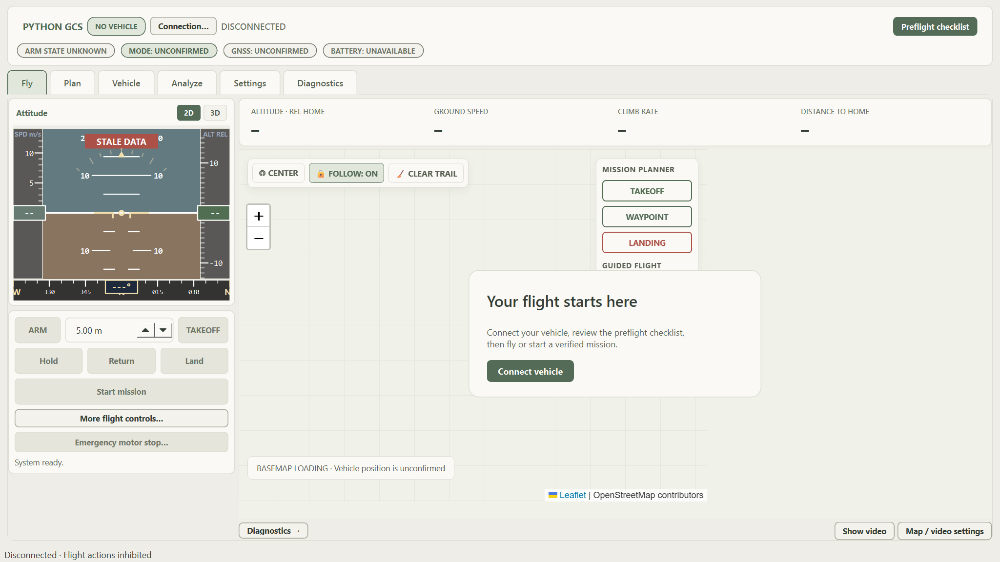

# PythonGCS

A Python desktop ground control station for PX4 and MAVLink multirotors. A focused flight screen keeps the map and essential actions visible, while planning, vehicle settings, analysis, and diagnostics have their own views.

**[Project website](https://harryz0305.github.io/python-gcs/)** · **[Browser demo](https://harryz0305.github.io/python-gcs/web_gcs.html)** · **[Labeled screen guide](https://harryz0305.github.io/python-gcs/guide/)**



Ivory panels, warm gray backgrounds, sage accents, and a system font are the default. Video and additional pilot controls open on demand. Diagnostics can move to a second window for another display.

## Implementation status

**Project description:** Customized drone GCS with OpenStreetMap, improved mission planning, an experimental telemetry-driven 3D attitude viewer, and implemented Gazebo/PX4 SITL simulation integration; real-aircraft validation remains work in progress.

| Capability                                       | Current status                                                                                                                                                                                            |
| ------------------------------------------------ | --------------------------------------------------------------------------------------------------------------------------------------------------------------------------------------------------------- |
| OpenStreetMap and mission planning               | **Implemented in the desktop app.** Map tiles, local mission editing, survey generation, and the supported `.plan` subset have code paths and software checks.                                            |
| Actual PX4 connection                            | **Connection code implemented; real-aircraft validation work in progress.** MAVLink transports and telemetry exist. Protocol tests do not establish flight readiness.                                     |
| Gazebo / PX4 SITL                                | **Implemented desktop Gazebo/PX4 SITL simulation integration.** Connects over MAVLink to a separately running simulator. Additional regression testing is separate from implementation status.            |
| Telemetry-driven 3D aircraft attitude            | **Experimental implementation; graphics and flight validation work in progress.** Requires WebGL. Displays aircraft orientation, not reconstructed 3D terrain.                                            |
| Browser aircraft connection and parameter writes | **Work in progress — planned, not implemented yet.** The current demo generates local data and sends no MAVLink commands.                                                                                 |
| Broader autonomy, 3D mapping and full replay     | **Work in progress — planned extensions.** Terrain following, geofence editing, calibration wizards, broader mission formats, terrain reconstruction, and full flight-log replay are not implemented yet. |

See [feature status and evidence](docs/feature-status.md). Work-in-progress labels identify unfinished scope, including planned work; they do not mean a feature is already available or has a committed delivery date.

## Six workspaces

| View            | Main features                                                                                                                         |
| --------------- | ------------------------------------------------------------------------------------------------------------------------------------- |
| **Fly**         | Attitude display, map, four key readings, state-aware flight actions, evidence-based preflight, optional video inset and 3D attitude. |
| **Plan**        | Map and table editing, undo/redo, survey grids, supported `.plan` import/export, mission upload/readback verification.                |
| **Vehicle**     | Parameter search, typed values, matching-readback confirmation, backup and restore difference preview.                                |
| **Analyze**     | Telemetry charts, flight events, CSV export, and separately labeled historical CSV review.                                            |
| **Settings**    | Appearance, camera sources, battery thresholds, cached maps and offline MBTiles.                                                      |
| **Diagnostics** | Independent stream freshness, trends, command acknowledgments, flight-trail KML export, and a detachable monitoring window.           |

The [screen guide](https://harryz0305.github.io/python-gcs/guide/) shows the six workspaces and principal dialogs and viewing modes in 17 labeled screenshots. Captions identify disconnected states and illustrative sample data.

## Try it in your browser

Open the [browser demo](https://harryz0305.github.io/python-gcs/web_gcs.html) and choose **Run sample flight**. Explore the six views, edit a local route, generate a survey, view charts, and open the diagnostics monitor in another window.

The demo generates its motion, readings, events, and test video locally. Browser connections to actual PX4, Gazebo, or an aircraft and browser parameter read/write are **work in progress (planned, not implemented yet)**. Today's demo sends no aircraft commands and uses read-only example parameters. Routes are session-only; appearance and flight preferences are stored locally when available.

The demo imports a deliberately narrow `.plan` subset: an auto-continuing home takeoff, waypoints with the default acceptance radius and no commanded yaw, and a home landing in relative-altitude frame. Takeoff altitude must match the first waypoint. Coordinates are displayed as offsets from the imported planned home; the browser does not reproduce geographic terrain or flight physics. Unsupported semantics cancel import.

## Run the desktop app

Requires Python 3.9+ and a compatible PX4 simulator or flight controller for vehicle workflows. The desktop uses PyQt6, PyQt6-WebEngine, pymavlink, pyqtgraph, and OpenCV.

```bash
git clone https://github.com/HarryZ0305/python-gcs.git
cd python-gcs
python -m pip install -r requirements.txt
python main.py
```

**Gazebo/PX4 SITL integration is implemented in the desktop app.** Install and configure the simulator separately, then start it from a configured [PX4-Autopilot](https://github.com/PX4/PX4-Autopilot) source checkout:

```bash
make px4_sitl gz_x500
```

In PythonGCS, open **Connection…**, choose the appropriate transport/profile (the default SITL profile listens on UDP 14540), and connect. Check the actual stream and preflight evidence before using flight actions. A heartbeat alone does not establish that the sensors or position are current.

1. **Connect:** select a simulator or vehicle connection.
2. **Prepare:** review preflight evidence and build a mission in Plan. Upload and verify the controller's readback before starting a desktop mission.
3. **Monitor:** keep Fly open; use Analyze or a second Diagnostics window for details.

### Keyboard and video

Open **Fly → More pilot controls…** to opt into keyboard flight control. W/S moves forward/back, A/D strafes, Q/E turns, I/K climbs/descends, and Space or H requests zero velocity. The desktop sends body-relative velocity targets with focus and typing guards, a dead-man timeout, and zero-velocity handling when focus is lost.

Configure RTSP, UDP, HTTP, USB, or a test pattern in **Settings**. Show video in Fly when needed; swap between video-primary and map-primary views. Generated test patterns are labeled separately from camera footage.

### Scope and validation

The desktop supports a documented subset of home-relative takeoff, waypoint, and landing missions. Broader mission support is **work in progress**; unsupported commands, complex items, frames, custom parameters, fences, and rally points currently cancel import. Historical CSV review is implemented; full flight-log replay is **work in progress (planned)**. Optional 3D attitude is **experimental**, depends on WebGL, and still needs graphics/flight validation.

Automated checks cover software behavior; real-aircraft acceptance is **work in progress**. Existing Gazebo/PX4 SITL integration remains implemented; this documentation review did not repeat a full simulator regression run. Read the [feature status](docs/feature-status.md), [implementation and validation notes](docs/desktop-upgrade.md), and [interface design comparison](docs/interface-design.md) for details.

## Development

Desktop regression checks:

```bash
python -m pip install -r requirements-dev.txt
python -m pytest tests -q
python -m compileall -q gcs tools
```

The website is buildless HTML, CSS, and JavaScript. GitHub Pages serves the root landing page, `web_gcs.html`, and `guide/` from `main`. Preview from the repository:

```bash
python -m http.server 8878
```

Open `http://localhost:8878/`. Use Node.js 22+ to run browser-model regression tests:

```bash
node --test tests/web-model.test.mjs
```

To build a local Windows executable:

```bash
pyinstaller PythonGCS.spec
```

The output is `dist/PythonGCS/PythonGCS.exe`; it is a local build artifact, not a download hosted by the project website.

## License

[MIT](LICENSE).
